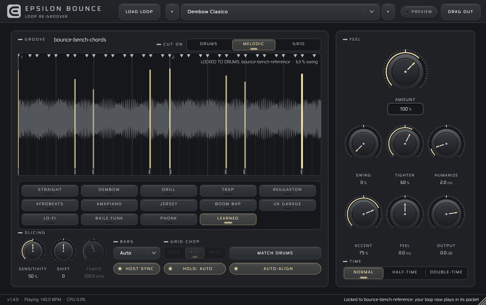

# Epsilon Bounce

**Lock any melody, flipped sample or drum loop to your drums' groove** — or to 13 genre pockets and 42 presets. Drop an audio loop on the grid: Bounce finds every hit, slices it, and plays the slices back on your DAW's tempo with the groove you pick — so a stiff loop bounces, a straight hat pattern shuffles like UK drill, and anything you sample lands in the pocket at your project's BPM.

## Install (no build needed)

**Mac (Intel and Apple Silicon):** download [Epsilon Bounce for Mac](https://github.com/Epsilonmuz/Epsilon-Bounce/releases/latest/download/Epsilon-Bounce-macOS-Installer.pkg). Double-click it: the VST3 goes to `/Library/Audio/Plug-Ins/VST3`, the Audio Unit to `/Library/Audio/Plug-Ins/Components` and the standalone app to Applications. Then rescan in your DAW (FL Studio: Options > Manage plugins > Find installed plugins). The first time, macOS may say it can't check the installer (it isn't notarised by Apple): click Done, then System Settings > Privacy & Security > **Open Anyway**. No Terminal commands needed. The link always gives the newest build of `main`; it is rebuilt, test-installed on GitHub's Mac and replaced on every push.

Part of the Epsilon line by **Epsilon Sounds**.

**Manual:** [Epsilon Bounce Manual (PDF)](docs/Epsilon%20Bounce%20Manual.pdf) (v1.5) - the melody and drums lanes, the Pocket switch, every control drawn, all 13 pockets and 42 presets, and tips. The interactive version with the playable Pocket Lab is `docs/manual.html`.

## Two lanes: melody + drums (v1.5)

Bounce holds **two loops**: a **MELODY** lane (melody, sample, chops) and a **DRUMS** lane (drums or percussion). Drop a file on a lane (or use Load melody / Load drums), and drag a lane - or its **Drag out** button - into your DAW to take that loop out as its own WAV.

**Pocket** decides who sets the feel when both lanes are loaded:

| Pocket | What happens |
|---|---|
| **DRUMS LEAD** (default) | The drums keep their own feel, untouched. Bounce reads their pocket and locks the melody into it. Markers along the top of the melody lane show where the drums hit. |
| **MELODY LEADS** | The melody keeps its feel; the drums are locked into the melody's pocket. |
| **GROOVE** | Both lanes ride the groove / preset you pick (dembow, drill, trap ...). |

Each lane has its own **Level** (fully down = off, e.g. when your drums already play in the DAW) and **Clear**. With one lane loaded Bounce works exactly as before. Both loops and the Pocket setting are saved in the session.

## Lock a melody to your drums (3 moves)

1. **Drop the melody** (or chords, or a flipped sample) on the grid. Bounce hears whether it's drums or a melody and picks the cut mode for you: notes and chord changes for melodies, hits for drums.
2. **Drop your drum loop on _Match drums_.** Bounce learns the drums' exact pocket (swing, laid-back snares, pushed hats) and locks the melody into it: Tighten 100 %, Amount 100 %, nothing added on top. Your drum hits show as markers along the top of the grid.
3. **Drag out** the locked loop into FL, or just keep Bounce playing on the channel.

Both loops are read on your project's tempo when they were made in it, so a reverb tail or a few ms of silence at the end no longer pushes the grid off. Loops up to 32 bars.

A sample that doesn't sit with your beat is one of four problems; Bounce fixes each:

| Problem | Fix |
|---|---|
| It swings differently from your drums | **Match drums** learns your drum loop's pocket; your drum hits show on the grid and the melody's notes move under them |
| It's early / late as a whole, or starts on a pickup | **Auto-align** (corrects samples cut a few ms off) and **Shift** (bar 1 by whole 16ths) |
| No drum-like hits to cut on | **Cut on: Melodic** (cuts where the notes / chords change) or **Grid** (even 16th / 8th / beat chops on zero crossings) |
| Moved notes leave gaps | **Hold** sustains each piece with a seamless loop of its own tail until the next one; 8 ms crossfaded cuts |

## How it works

1. **Load** — drag a WAV/AIFF/FLAC onto the grid (or *Load loop*). Up to 60 seconds.
2. **Slice** — spectral-flux onset detection finds each hit, then walks back to where the attack really starts and keeps 3 ms of pre-roll so transients stay intact. The bar count is guessed from the length (tempo between 85 and 170 BPM), or set it with *Bars*.
3. **Re-groove** — every slice is placed on the 16th grid, pulled toward it by *Tighten*, then moved by the pocket. 13 pockets: STRAIGHT, DEMBOW, DRILL, TRAP, REGGAETON, AFROBEATS, AMAPIANO, JERSEY, BOOM BAP, UK GARAGE, LO-FI, BAILE FUNK, PHONK, plus **LEARNED** — the feel copied from any reference loop with *Learn groove* (or Alt-drop on the grid). 42 presets give each genre 3–4 takes (more swing, tighter, pushed or laid back), and *Time* plays the loop at half or double time.
4. **Play** — slices trigger from the host playhead (sample-accurate, follows tempo changes and loop jumps). Each new hit chokes the last with a 4 ms fade, so moved hits leave clean gaps, not clicks. With the host stopped, *Preview* plays at the *Tempo* knob.
5. **Drag out** — hold *Drag out* and drop into a track: a 24-bit WAV of two loops, re-grooved at your project tempo. Files are kept in *Music/Epsilon Sounds/Epsilon Bounce/* (FL links dragged audio by its location, so not a temp folder), and a new take never overwrites one a project already uses.

The champagne bars on the grid show where each hit lands; the small hollow ticks at the bottom show where it was, joined by a line — you see the bounce.

| Control | What it does |
|---|---|
| Amount (hero) | How much of the groove template is applied, 0–150 % |
| Swing | Extra delay on off-16ths, up to a full triplet feel |
| Tighten | Pulls the original timing onto the grid before the groove |
| Humanize | Random timing per hit, up to ±20 ms, the same every playback |
| Accent | Applies the groove's level accents |
| Feel | Push (−) or lay back (+) the whole loop, ±20 ms |
| Output | Output level |
| Sensitivity | More = more slices (catches ghost notes) |
| Tempo / Host sync | Preview tempo when the host isn't playing |

The loop is saved inside your session (FLAC-compressed), so projects reopen with it loaded.

## Build

**Projucer (the usual way):** open `Epsilon-Bounce.jucer` in Projucer 9.0.5, then *Save and Open in IDE*. Projucer packages from Claude ship with JUCE in `JUCE/` and the generated `Builds/`. Every configuration — Debug included — is optimised (-O3), because Xcode's Build/Run uses Debug.

**CMake:** `git clone --depth 1 --branch 9.0.5 https://github.com/juce-framework/JUCE.git JUCE`, then
`cmake -S . -B build -DCMAKE_BUILD_TYPE=Release && cmake --build build`.

## Performance (v1.4)

Measured on the test machine with a 59-second melody at 48 kHz, 128-sample blocks (CI repeats this on an Intel Mac):

| | before 1.4 | 1.4 |
|---|---|---|
| FL saving the project (undo, autosave) | 265 ms freeze, every save | 1.5 ms |
| Analysing the melody | 3.5 s, and every Sensitivity move queued another | 1.4 s, off the UI thread; an out-of-date run is dropped |
| Starting a drag-out | 118 ms | 17 ms (rendered while the mouse is on the button) |
| A playback frame of the grid | repainted the panel behind it too | grid only, 1.1 ms |
| Audio thread, a knob automated every block | 0.06 ms of 2.67 | unchanged |

## Tests

- `BounceEngineTests` — 101 checks, including (1.4) drums-vs-melody detection, a 16-bar loop read as 16 bars, a drum loop with a reverb tail landing exactly on its 16ths, a 92 BPM sample keeping its own grid in a 140 project, cancelled analysis, speed, and a straight melody locked note-for-note into a learned swung pocket. Also the original 88 at 44.1 and 48 kHz: onset accuracy (< 1.5 ms), every hit on the right 16th, playback timing (< 1 ms), each groove's offsets, all 13 pockets distinct and bounded, Groove Learn recovering a known swing and late snare, melodic cutting finding all smooth chord changes (and not splitting a vibrato note), grid cuts on zero crossings, auto-align of a 25 ms offset, Hold filling gaps with no clicks, tempo follow, humanize stability, level bounds, silence, and speed (render < 2 % of a core, analysis < 2 s).
- `BounceBench` (`-DBOUNCE_BUILD_BENCH=ON`; on Linux add `-DBOUNCE_LINUX_BENCH=ON`) — starts with the lag profile above (load, analysis, host save and reopen, audio blocks under automation, drag-out, grid repaint), then drives the real plugin like a DAW: loads a WAV, plays it on a 140 BPM playhead, checks every groove at max, all 42 presets, half/double time, learning from a reference WAV, melodic / grid cutting and Hold through the real plugin (half-time chords: no gaps, no clicks), stopped/preview behaviour, session round-trip with the loop inside, drag-out render, and writes UI snapshots.
- CI (`.github/workflows/build.yml`) builds universal VST3/AU/Standalone on macOS 15 and runs all of the above plus `auval` and `pluginval` at strictness 8; `perf.yml` times the engine on Intel and Apple Silicon Macs.

## Look

The UI uses the shared Epsilon Sounds design system (`Shared/epsilon_ui/`): Epsilon tier (graphite + platinum), champagne only for what's live, the Hallmark logo as vector art. Since 1.3 it is set in **Epsilon Dial**, the house typeface (`Resources/EpsilonDial-*.ttf`, proprietary to Epsilon Sounds), and uses the signature controls in `EpsilonControls.h`: coin-edge knobs with a floating lume tip, keycaps with a lume bar, pills with an LED jewel, and value windows. The app icon is the Bounce product symbol.
