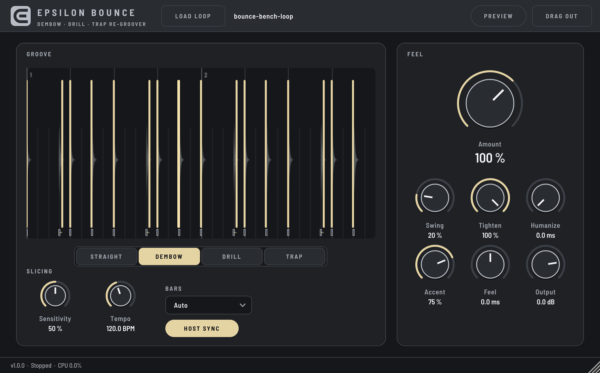

# Epsilon Bounce

**Re-groove any loop into 13 genre pockets, 42 presets, or the exact feel of any reference loop.** Drop an audio loop on the grid: Bounce finds every hit, slices it, and plays the slices back on your DAW's tempo with the groove you pick — so a stiff loop bounces, a straight hat pattern shuffles like UK drill, and anything you sample lands in the pocket at your project's BPM.

Part of the Epsilon line by **Epsilon Sounds**.

**Manual:** [Epsilon Bounce Manual (PDF)](docs/Epsilon%20Bounce%20Manual.pdf) - every control drawn, all 13 pockets and 42 presets, Groove Learn, and tips. The interactive version with the playable Pocket Lab is `docs/manual.html`.

## How it works

1. **Load** — drag a WAV/AIFF/FLAC onto the grid (or *Load loop*). Up to 60 seconds.
2. **Slice** — spectral-flux onset detection finds each hit, then walks back to where the attack really starts and keeps 3 ms of pre-roll so transients stay intact. The bar count is guessed from the length (tempo between 85 and 170 BPM), or set it with *Bars*.
3. **Re-groove** — every slice is placed on the 16th grid, pulled toward it by *Tighten*, then moved by the pocket. 13 pockets: STRAIGHT, DEMBOW, DRILL, TRAP, REGGAETON, AFROBEATS, AMAPIANO, JERSEY, BOOM BAP, UK GARAGE, LO-FI, BAILE FUNK, PHONK, plus **LEARNED** — the feel copied from any reference loop with *Learn groove* (or Alt-drop on the grid). 42 presets give each genre 3–4 takes (more swing, tighter, pushed or laid back), and *Time* plays the loop at half or double time.
4. **Play** — slices trigger from the host playhead (sample-accurate, follows tempo changes and loop jumps). Each new hit chokes the last with a 4 ms fade, so moved hits leave clean gaps, not clicks. With the host stopped, *Preview* plays at the *Tempo* knob.
5. **Drag out** — hold *Drag out* and drop into a track: a 24-bit WAV of two loops, re-grooved at your project tempo.

The champagne bars on the grid show where each hit lands; the small hollow ticks at the bottom show where it was, joined by a line — you see the bounce.

| Control | What it does |
|---|---|
| Amount (hero) | How much of the groove template is applied, 0–150 % |
| Swing | Extra delay on off-16ths, up to a full triplet feel |
| Tighten | Pulls the original timing onto the grid before the groove |
| Humanize | Random timing per hit, up to ±20 ms, the same every playback |
| Accent | Applies the groove's level accents |
| Feel | Push (−) or lay back (+) the whole loop, ±20 ms |
| Output | Output level |
| Sensitivity | More = more slices (catches ghost notes) |
| Tempo / Host sync | Preview tempo when the host isn't playing |

The loop is saved inside your session (FLAC-compressed), so projects reopen with it loaded.

## Build

**Projucer (the usual way):** open `Epsilon-Bounce.jucer` in Projucer 9.0.5, then *Save and Open in IDE*. Projucer packages from Claude ship with JUCE in `JUCE/` and the generated `Builds/`. Every configuration — Debug included — is optimised (-O3), because Xcode's Build/Run uses Debug.

**CMake:** `git clone --depth 1 --branch 9.0.5 https://github.com/juce-framework/JUCE.git JUCE`, then
`cmake -S . -B build -DCMAKE_BUILD_TYPE=Release && cmake --build build`.

## Tests

- `BounceEngineTests` — 58 checks at 44.1 and 48 kHz: onset accuracy (< 1.5 ms), every hit on the right 16th, playback timing (< 1 ms), each groove's offsets, all 13 pockets distinct and bounded, Groove Learn recovering a known swing and late snare, tempo follow, humanize stability, level bounds, silence, and speed (render < 2 % of a core, analysis < 2 s).
- `BounceBench` (`-DBOUNCE_BUILD_BENCH=ON`) — drives the real plugin like a DAW: loads a WAV, plays it on a 140 BPM playhead, checks every groove at max, all 42 presets, half/double time, learning from a reference WAV, stopped/preview behaviour, session round-trip with the loop inside, drag-out render, and writes UI snapshots.
- CI (`.github/workflows/build.yml`) builds universal VST3/AU/Standalone on macOS 15 and runs all of the above plus `auval` and `pluginval` at strictness 8; `perf.yml` times the engine on Intel and Apple Silicon Macs.

## Look

The UI uses the shared Epsilon Sounds design system (`Shared/epsilon_ui/`): Epsilon tier (graphite + platinum), champagne only for what's live, the Hallmark logo as vector art.
